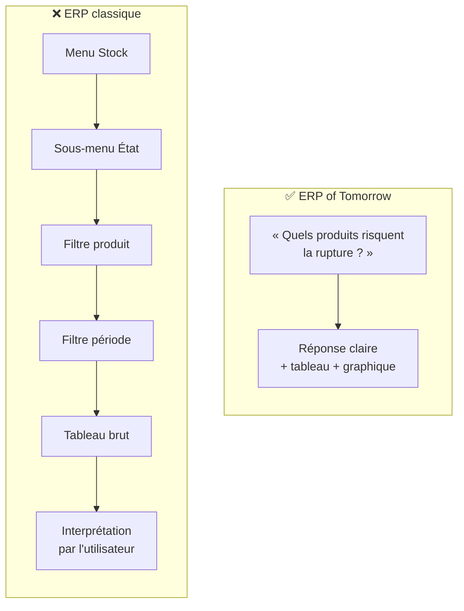
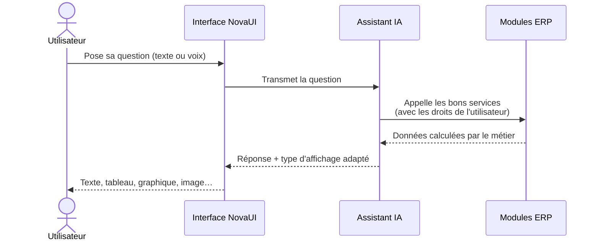
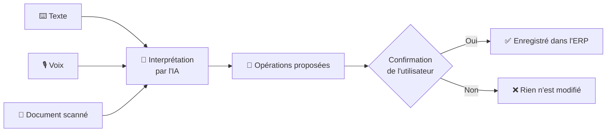
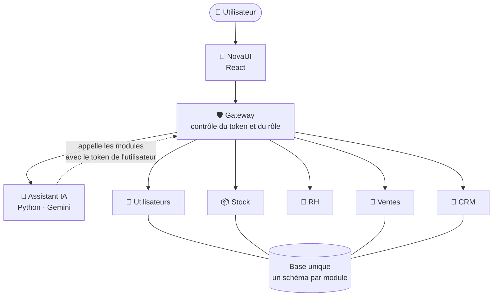
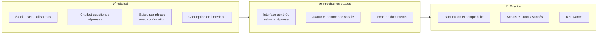

# 🚀 ERP of Tomorrow

### L'ERP qui se parle, s'écoute et s'affiche tout seul

*Documentation fonctionnelle · DevFest*

---

## 🧭 Sommaire

| # | Partie |
|:-:|--------|
| 01 | [Le constat](#01--le-constat) |
| 02 | [Notre vision](#02--notre-vision) |
| 03 | [Avant / Après](#03--avant--après) |
| 04 | [Pilier 1 : demander au lieu de chercher](#04--pilier-1--demander-au-lieu-de-chercher) |
| 05 | [Pilier 2 : raconter au lieu de saisir](#05--pilier-2--raconter-au-lieu-de-saisir) |
| 06 | [Ce qui est déjà réalisé](#06--ce-qui-est-déjà-réalisé) |
| 07 | [Architecture](#07--architecture) |
| 08 | [Sécurité et confiance](#08--sécurité-et-confiance) |
| 09 | [Feuille de route](#09--feuille-de-route) |

---

## 01 · Le constat

> **Les ERP d'aujourd'hui sont puissants, mais ils font travailler l'utilisateur pour le logiciel.**

| | Problème | Ce que vit l'utilisateur |
|:-:|----------|--------------------------|
| 🧩 | **Trop de navigation et de filtres** | Pour voir l'état du stock : ouvrir le module, choisir le menu, filtrer par produit, par date, par entrepôt… |
| 📊 | **Des données, pas des réponses** | Un tableau d'analyse ne dit rien tout seul : il faut l'interpréter pour en tirer une information. |
| 🎓 | **Une formation par ERP** | Chaque logiciel a ses écrans et sa logique : chaque utilisateur doit être formé spécifiquement. |
| ⌨️ | **Beaucoup de saisie** | Chaque entrée et chaque sortie de stock se saisit à la main, ligne par ligne. |

---

## 02 · Notre vision

### *« On parle à l'ERP comme à un collègue. Il comprend, il agit, il montre. »*

Deux piliers :

| Pilier | Idée | En pratique |
|:------:|------|-------------|
| 💬 **1. Demander** | L'ERP devient **conversationnel et interactif**. | Un **avatar** à qui l'on parle, ou une zone de saisie comme ChatGPT. En retour, l'ERP **génère l'interface adaptée à la réponse** : tableau, graphique, image, fiche… |
| 🎙️ **2. Raconter** | La saisie devient **un récit**. | On raconte ce qui s'est passé, l'ERP **déduit les opérations à enregistrer**. Un **document scanné** (bon de livraison, facture) est interprété de la même façon. |

---

## 03 · Avant / Après

| | ERP classique | ERP of Tomorrow |
|---|---------------|-----------------|
| **Trouver une information** | 5 à 10 clics et filtres | Une question |
| **Comprendre une analyse** | L'utilisateur interprète | L'ERP explique et met en forme |
| **Prise en main** | Formation spécifique | Parler sa propre langue suffit |
| **Saisir une opération** | Formulaire ligne par ligne | Une phrase, un vocal ou un scan |

---

## 04 · Pilier 1 : demander au lieu de chercher

### 🗣️ Un exemple

> **Utilisateur :** *« Est-ce que je vais manquer de quelque chose cette semaine ? »*
>
> **ERP :** *« Oui, deux produits sont critiques. Le riz n'a plus qu'environ **2 jours** de stock et l'huile **5 jours**. Voici le détail : »*
>
> | Produit | Stock | Vendu / jour | Jours restants | Risque |
> |---------|------:|-------------:|---------------:|:------:|
> | Riz 25 kg | 12 | 6 | 2 | 🔴 Critique |
> | Huile 5 L | 30 | 6 | 5 | 🟠 Alerte |
> | Sucre 1 kg | 200 | 10 | 20 | 🟢 OK |

### ⚙️ Comment ça marche

### 🎨 L'interface s'adapte à la réponse

| La question porte sur… | L'ERP affiche… |
|------------------------|----------------|
| Une liste (produits en alerte, employés d'un service) | 📋 un **tableau** |
| Une évolution (ventes du mois, sorties de stock) | 📈 un **graphique** |
| Un élément précis (un produit, un employé) | 🪪 une **fiche** |
| Un chiffre clé (valeur du stock, effectif) | 🔢 un **indicateur** |

> [!TIP]
> Les calculs (jours de stock restants, niveau de risque, soldes de congés…) sont faits **par les modules métier**, jamais « devinés » par l'IA. L'IA comprend la question et met en forme la réponse.

---

## 05 · Pilier 2 : raconter au lieu de saisir

### 🗣️ Un exemple

> **Magasinier :** *« Ce matin on a reçu 50 sacs de riz du fournisseur Ravinala, et on en a sorti 8 pour la boutique d'Analakely. »*
>
> **ERP :** *« J'ai compris deux opérations. Je les enregistre ? »*
>
> | Opération | Produit | Quantité | Détail |
> |-----------|---------|---------:|--------|
> | ⬇️ Entrée | Riz 25 kg | 50 | Fournisseur Ravinala |
> | ⬆️ Sortie | Riz 25 kg | 8 | Boutique Analakely |
>
> **[ ✅ Confirmer ]  [ ❌ Annuler ]**

### 🔁 Trois façons de saisir, un seul traitement

> [!IMPORTANT]
> **Aucune écriture sans confirmation.** L'IA propose, l'utilisateur valide. Une opération validée ne se modifie plus : une erreur se corrige par une nouvelle opération (mouvement inverse, avoir).

---

## 06 · Ce qui est déjà réalisé

| | Fonctionnalité | Ce que l'on peut faire | Statut |
|:-:|----------------|------------------------|:------:|
| 📦 | **Gestion de stock** | Produits, entrées et sorties, alertes de seuil, **autonomie et risque de rupture** par produit, fournisseurs, bons de commande (création, validation, réception) | ✅ |
| 👥 | **Gestion RH** | Départements, employés, demandes et validation de congés avec solde, pointage, résumé de l'effectif | ✅ |
| 🔐 | **Gestion des utilisateurs** | Comptes, connexion sécurisée, **un rôle par métier** (Stock, Vente, RH, CRM, Admin) | ✅ |
| 💬 | **Chatbot** | Poser des questions en langage naturel sur l'ERP et obtenir une réponse ; demander une opération (mouvement de stock, bon de commande) avec **confirmation par bouton** | ✅ |
| 🎨 | **Interface utilisateur** | Conception d'une interface adaptée au projet (NovaUI) | ✅ |

> [!NOTE]
> Le socle contient aussi les modules **Ventes** (clients, ventes, chiffre d'affaires, meilleurs produits) et **CRM** (fiches clients et fournisseurs), accessibles au chatbot.

### 🤖 Ce que le chatbot sait déjà faire

| Lire | Agir (après confirmation) |
|------|---------------------------|
| État du stock et produits à risque | Enregistrer une entrée ou une sortie de stock |
| Autonomie d'un produit, historique des mouvements | Créer un bon de commande |
| Résumé du stock (valeur, produits en alerte) | Valider un bon de commande |
| Fournisseurs et bons de commande | Réceptionner une commande |
| Ventes, clients, chiffre d'affaires | |
| Employés, congés, effectif | |

---

## 07 · Architecture

| Principe | Pourquoi |
|----------|----------|
| **Un module = un service = un schéma** (une seule base PostgreSQL) | Chaque métier évolue indépendamment. |
| **Une seule porte d'entrée (la gateway)** | Sécurité centralisée, une seule adresse pour l'interface. |
| **L'IA passe par la même porte que l'utilisateur** | Elle ne voit que ce que l'utilisateur a le droit de voir. |
| **Le métier calcule, l'IA explique** | Des chiffres fiables, une présentation compréhensible. |

---

## 08 · Sécurité et confiance

| | Garantie |
|:-:|----------|
| 🔑 | Connexion obligatoire, chaque requête porte un jeton sécurisé. |
| 🚧 | Chaque rôle ne voit que son module : un compte RH n'accède ni au stock ni aux ventes. |
| 🤖 | L'assistant hérite des droits de l'utilisateur connecté, jamais plus. |
| ✋ | Aucune modification par l'IA sans clic de confirmation. |
| 🔒 | Une donnée validée (congé, bon de commande, vente) devient **non modifiable**. |

---

## 09 · Feuille de route

| Étape | Objectif | Pilier |
|-------|----------|:------:|
| 🖥️ **Interface générée** | L'écran se construit selon la réponse : tableau, graphique, fiche, indicateur. | 💬 1 |
| 🧑‍🚀 **Avatar et voix** | Parler à l'ERP et l'entendre répondre. | 💬 1 · 🎙️ 2 |
| 📄 **Scan de documents** | Photographier un bon de livraison ou une facture pour créer les opérations. | 🎙️ 2 |

---

### 💡 En une phrase

**ERP of Tomorrow remplace les menus, les filtres et les formulaires par une conversation : on demande, on raconte, l'ERP comprend, agit et affiche.**

