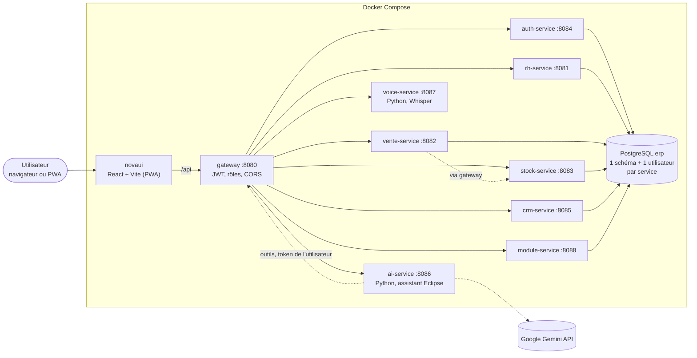
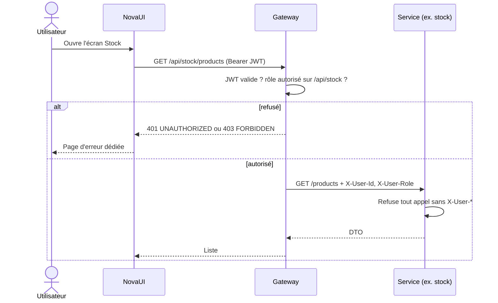
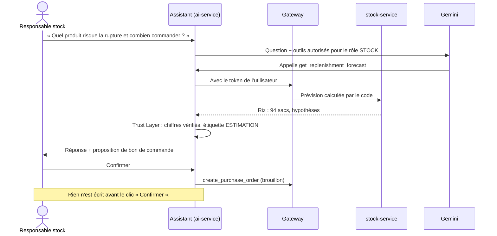
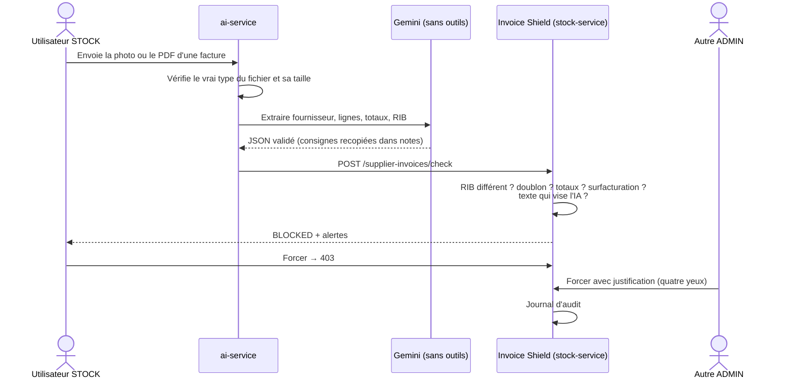
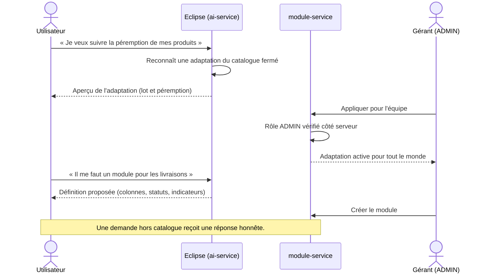

# ERP of Tomorrow — NOVA

> **Équipe songomby_d2** · DevFest Antananarivo 2026 · Thème *« The ERP of tomorrow »*
> Sujet général : *« AI is one step ahead : will you fight them or exploit them ? »*

Ce document est le **point de repère du jury et de l'équipe** : il présente le projet, l'architecture, les choix techniques, ce qui existait avant la reprise du dépôt, ce que l'équipe a ajouté, et comment lancer l'application.

## Sommaire

1. [NOVA en 2 minutes](#1-nova-en-2-minutes)
2. [Historique du dépôt et contributeurs](#2-historique-du-dépôt-et-contributeurs)
3. [État d'avancement](#3-état-davancement)
4. [Architecture](#4-architecture)
5. [Choix techniques et pourquoi](#5-choix-techniques-et-pourquoi)
6. [Fonctionnalités](#6-fonctionnalités)
7. [Comment ça fonctionne (diagrammes de séquence)](#7-comment-ça-fonctionne-diagrammes-de-séquence)
8. [Lancer le projet](#8-lancer-le-projet)
9. [Variables d'environnement](#9-variables-denvironnement)
10. [Structure du dépôt](#10-structure-du-dépôt)
11. [Sécurité](#11-sécurité)
12. [Tests et qualité](#12-tests-et-qualité)
13. [Feuille de route](#13-feuille-de-route)
14. [Documentation et règles d'équipe](#14-documentation-et-règles-déquipe)
15. [Glossaire](#15-glossaire)

---

## 1. NOVA en 2 minutes

### Le problème

Beaucoup d'entreprises gèrent leurs ressources humaines, leurs stocks, leurs ventes et leur relation client avec des outils séparés : données dispersées, saisies manuelles, peu de visibilité, fraude à la facture difficile à repérer.

### Notre solution

**NOVA** est un ERP **intelligent et modulaire** en microservices : Stock, Ventes, RH, Relations (CRM) et comptes dans une seule application web, avec un assistant IA, **Eclipse**, présent sur chaque écran.

### Notre réponse au thème : « Exploit + Fight »

| | Ce que fait NOVA |
|---|---|
| **Exploit** — on exploite l'IA | Assistant qui répond sur les données de l'entreprise (texte ou voix), prévision de réapprovisionnement explicable, lecture automatique des factures, adaptation d'un écran ou création d'un module métier à partir d'une simple phrase |
| **Fight** — on combat ses risques | L'IA n'a **que** les droits de l'utilisateur ; elle **propose**, un humain **confirme** ; les chiffres cités sont vérifiés contre les données ; les factures piégées (faux RIB, doublon, surfacturation, texte qui cherche à manipuler l'IA) sont bloquées par **Invoice Shield** ; chaque action IA est journalisée |

> Un ERP classique enregistre ce que fait l'entreprise. NOVA comprend, anticipe et propose — **sans jamais voir ni faire plus que la personne qui l'utilise.**

---

## 2. Historique du dépôt et contributeurs

Le dépôt a été **créé par une première équipe** (21/11/2026), puis **repris par l'équipe songomby_d2** (à partir du 22/11/2026). Le point de reprise est le commit `d7b7e72` (« dockeriser la gateway et les services »), plus trois branches de l'équipe d'origine fusionnées ensuite telles quelles (voix en temps réel, design NovaUI, assistant IA).

| Période | Contributeurs (identité git) | Apport principal |
|---|---|---|
| **Avant la reprise** | Josoa | Monorepo, services Vente, RH, Stock, CRM, Swagger, docker compose, voice-service |
| | IotyRandrianoely | Assistant IA (ai-service, FastAPI + Gemini) |
| | mirana-voniarintsoa | Dépendances du voice-service |
| | MAMIARILAZA To | Premier design de NovaUI, connexion et tableau de bord |
| **Après la reprise (songomby_d2)** | Arthinez | Gestion des comptes, sécurité de la gateway, tests, Invoice Shield, prévision, Trust Layer IA, CI, données et scénario de démo, finition du socle NOVA |
| | saotra | Intégration des maquettes Figma NOVA : design system et shell, Eclipse, moteur de modules (module-service), lots et péremption, avances sur salaire, nom complet des comptes |
| | Nekena Rabeharivonjy | Environnement de développement à chaud, base PostgreSQL unique, front web unique, migration Tailwind et TanStack Router ; écrans Accueil, Équipe et Relations, réponses d'Eclipse dans le dock, ports internes non publiés |
| | herifanantenana | Écran Ventes (nouvelle vente, encaissement, annulation, adaptation paiement), adaptation lots et péremption sur l'écran Stock |

Le détail des ajouts, avec leur auteur, est à la [section 6.2](#62-nouvelles-fonctionnalités-new_features-ajoutées-depuis-la-reprise).

---

## 3. État d'avancement

| Statut | Signification |
|---|---|
| **En place** | Codé, testé et présent dans le dépôt |
| **En cours** | Commencé ; du travail reste à relire ou à finir ([docs/integration-nova/SUITE.md](docs/integration-nova/SUITE.md)) |
| **Prévu** | Conçu et planifié pour une version suivante |

**Aujourd'hui** : le backend est complet pour la démonstration (8 services + gateway, plus de 1 000 tests Java, 228 tests Python, 628 tests front). Le front NOVA a son socle complet (design system, shell, navigation par rôle, gabarit d'écran de module, page d'erreur) ; les écrans Accueil, Mon profil, Stock, Ventes, Équipe et Relations sont faits ; Eclipse répond dans le dock (texte ou voix) et crée des modules affichés dans un écran de module générique. Restent **en cours** : les données de démonstration complètes et la vérification de bout en bout.

---

## 4. Architecture

### 4.1 Vue d'ensemble

NOVA est en **microservices** : un module métier = un service Spring Boot, derrière une gateway unique. Une seule application web (NovaUI) sert tous les modules.



### 4.2 Rôle de chaque bloc

| Bloc | Port | À quoi il sert | Origine |
|---|---|---|---|
| **gateway** | 8080 | Porte d'entrée unique : vérifie le JWT et le rôle, retire le préfixe, transmet l'identité (`X-User-*`), CORS | Avant la reprise ; CORS, voix et modules ajoutés depuis |
| **auth-service** | 8084 | Comptes, connexion, JWT | Avant ; gestion des comptes ajoutée depuis |
| **rh-service** | 8081 | Départements, employés, congés, pointage, avances | Avant ; enrichi depuis |
| **vente-service** | 8082 | Clients, ventes, chiffre d'affaires, encaissements | Avant ; enrichi depuis |
| **stock-service** | 8083 | Produits, mouvements, fournisseurs, bons de commande, lots, factures, prévision | Avant ; Invoice Shield, prévision, lots ajoutés depuis |
| **crm-service** | 8085 | Échanges avec clients et fournisseurs, chronologie | Avant |
| **ai-service** | 8086 | Assistant Eclipse (Gemini) : chat, outils filtrés par rôle, lecture de factures, propositions d'adaptation et de module | Avant ; Trust Layer et Eclipse ajoutés depuis |
| **voice-service** | 8087 | Voix vers texte en local (faster-whisper), fichier ou temps réel | Avant |
| **module-service** | 8088 | Moteur de modules créés par l'équipe (Livraisons, Réparations, Rendez-vous…) et activation des adaptations | **Nouveau** |
| **novaui** | 5173 | Application web unique, tous les modules | Avant (premier design) ; refaite sur les maquettes NOVA depuis |
| **PostgreSQL** | 5432 | Base `erp`, un schéma et un utilisateur par service | **Nouveau** (avant : une base par service) |

### 4.3 Routage de la gateway

| Préfixe | Service |
|---------|---------|
| `/api/rh/**` | rh-service (8081) |
| `/api/vente/**` | vente-service (8082) |
| `/api/stock/**` | stock-service (8083) |
| `/api/auth/**` | auth-service (8084) |
| `/api/crm/**` | crm-service (8085) |
| `/api/ai/**` | ai-service (8086) |
| `/api/voice/**` | voice-service (8087) |
| `/api/modules/**` | module-service (8088) |

Le préfixe est retiré avant d'atteindre le service (`/api/stock/products` → `/products`). La communication entre services passe aussi par la gateway.

### 4.4 Organisation du code

- **Service Spring Boot** : `<entité>/{controller, service/{reader,creator,updater,deleter}, repository, entity, dto, mapper}` + `common/{exception, config}`. Interfaces par responsabilité (SOLID), DTO uniquement.
- **Front (`novaui/`)** : `src/{components/common, screens, hooks, services, types, utils, constants, navigation}` ; le code propre à un module va dans `src/features/<module>/` (`components`, `hooks`, `services`, `types`). Aucun appel API dans un composant.
- **100 lignes maximum par fichier**, une responsabilité par fichier ([docs/REGLES_DEVELOPPEMENT.md](docs/REGLES_DEVELOPPEMENT.md)).

---

## 5. Choix techniques et pourquoi

| Domaine | Choix | Pourquoi |
|---|---|---|
| Services métier | **Java 17 + Spring Boot** | Robuste pour les transactions (stock, ventes) ; une équipe par service |
| Gateway | **Spring Cloud Gateway** | Un seul point de contrôle du JWT, des rôles et du CORS |
| Base de données | **Une instance PostgreSQL, un schéma par service** | Isolation des microservices garantie par la base, sans le coût de plusieurs serveurs ([ADR-006](docs/adr/ADR-006-instance-postgresql-unique.md)) |
| IA | **Python + FastAPI + Google Gemini** | Appel d'outils, lecture de PDF et d'images, sortie JSON structurée ; pas de GPU à gérer |
| Voix | **faster-whisper** en local | Fonctionne hors ligne, aucune donnée audio envoyée à l'extérieur |
| Front | **React + Vite + TanStack Router + Tailwind** | Routage typé, contrôle du rôle par route, design system NOVA en jetons |
| Application installable | **PWA** | Installation sur ordinateur et mobile |
| Déploiement | **Docker Compose** (+ `docker-compose.dev.yml` à chaud) | Toute la pile démarre avec une commande |
| Qualité | **GitHub Actions** | Tests Java, Python et front, lint et build à chaque Pull Request |

Les décisions et leurs raisons sont dans [docs/adr/](docs/adr/README.md).

### Ce que nous avons volontairement écarté

| Option | Raison |
|---|---|
| Moteur ReBAC complet | Réécriture complète de la sécurité, incompatible avec le délai ; les droits restent les rôles de la gateway |
| Une base PostgreSQL par service | Trop lourd pour une petite équipe ; remplacé par un schéma et un utilisateur par service |
| Une application par module | Remplacée par une seule application web, NovaUI |
| Création de module par code généré | Remplacée par un **moteur de modules générique** : un module est une définition, pas du code |

---

## 6. Fonctionnalités

### 6.1 Fonctionnalités présentes avant la reprise

Implémentées par l'équipe d'origine (Josoa, IotyRandrianoely, mirana-voniarintsoa, MAMIARILAZA To), jusqu'au commit `d7b7e72` et dans les trois branches fusionnées ensuite.

| Domaine | Fonctionnalités | Auteur |
|---|---|---|
| **Socle** | Monorepo, gateway avec routage par préfixe, JWT et contrôle du rôle par module, docker compose de tous les services, documentation des variables d'environnement | Josoa |
| **Accès** | Connexion par email et mot de passe (JWT), création et liste des comptes (ADMIN), compte admin initial | Josoa |
| **Ventes** | Clients et fiche 360 (total acheté, panier moyen, produits préférés) ; ventes en brouillon, validation qui débite le stock (avec restauration si une ligne échoue) ; chiffre d'affaires par période et par jour ; meilleurs produits | Josoa |
| **RH** | Départements, employés, congés (contrôle du solde et des chevauchements, validation ou refus), pointage avec durée travaillée, résumé (effectif, absents du jour) | Josoa |
| **Stock** | Produits, mouvements d'entrée et de sortie, alertes de seuil, autonomie et risque de rupture (`OK`, `WARNING`, `CRITICAL`), état de stock complet, fournisseurs et fiche 360, bons de commande (brouillon, validation, réception qui crée les entrées) | Josoa |
| **CRM** | Historique des échanges (appel, email, réunion, visite, note), chronologie unifiée d'un client ou d'un fournisseur ; Swagger unique sur la gateway | Josoa |
| **Assistant IA** | Chat en langage naturel (Gemini), réponse complète ou en flux ; outils de lecture sur tous les modules avec le token de l'utilisateur ; écritures (mouvement, bon de commande, vente) après confirmation explicite ; historique ; page de test `/api/ai/ui` | IotyRandrianoely |
| **Voix** | voice-service : transcription d'un fichier audio, transcription en temps réel par WebSocket, page de démonstration | Josoa, mirana-voniarintsoa |
| **Front** | Premier design de NovaUI, écran de connexion et tableau de bord par rôle | MAMIARILAZA To |
| **Tests** | 124 tests Java, 37 tests de l'assistant | — |

### 6.2 Nouvelles fonctionnalités (new_features) ajoutées depuis la reprise

#### Comptes, gateway et fiabilité — *Arthinez* (PR #12 à #26)

| Fonctionnalité | Détail |
|---|---|
| Gestion des comptes | Changement de rôle, désactivation et réactivation (ADMIN) ; changement de son propre mot de passe ; un admin ne peut ni se désactiver ni changer son propre rôle |
| Lien compte ↔ employé | `userId` optionnel sur la fiche employé, un compte par employé au plus |
| CORS sur la gateway | Les applications web peuvent appeler l'API ; origines réglables par `CORS_ALLOWED_ORIGINS` |
| Accès uniquement par la gateway | Chaque service refuse (401) un appel sans les en-têtes `X-User-*` |
| Format d'erreur commun | Toutes les erreurs, y compris inattendues, au format `{status, type, message, timestamp}` |
| Correction Stock | Suppression d'un produit qui a un historique refusée (avant : historique orphelin en silence) |
| Tests `@WebMvcTest` | Tous les controllers des 5 services : de 124 à 385 tests |

Détail : [docs/BILAN_SONGOMBY_D2.md](docs/BILAN_SONGOMBY_D2.md).

#### IA « Exploit + Fight » — *Arthinez* (PR #28 à #33, #40)

| Fonctionnalité | Détail |
|---|---|
| **Invoice Shield** | Contrôle anti-fraude de chaque facture fournisseur : fournisseur inconnu, doublon, RIB différent ou non vérifié, totaux faux, date incohérente, **texte qui cherche à manipuler l'IA** (français, anglais, malgache), écart avec le bon de commande, surfacturation, montant inhabituel. Verdict `CLEAR`, `WARNING` ou `BLOCKED` ; forcer une facture bloquée exige un ADMIN autre que l'auteur, avec justification (quatre yeux) ; journal d'audit |
| **Prévision de réapprovisionnement** | Sur 28 jours : consommation moyenne, stock de sécurité (niveau de service 95 %), point de commande, quantité recommandée, hypothèses explicites ; `INSUFFICIENT_DATA` si moins de 14 jours |
| **Lecture de facture par l'IA** | Photo ou PDF → Gemini **sans outils** → JSON validé → Invoice Shield ; le document est toujours traité comme une donnée non fiable |
| **Trust Layer** | Les nombres cités par l'assistant sont vérifiés contre les résultats des outils ; étiquette `FACT`, `ESTIMATION`, `RECOMMENDATION` ; réponses en français, malgache ou anglais, montants en Ariary |
| **Journal IA et limite de débit** | Chaque interaction journalisée (sans token ni donnée sensible), `GET /api/ai/audit` réservé à ADMIN ; 20 requêtes par minute et par utilisateur |
| Prévision dans l'assistant | L'assistant dit combien commander et pourquoi, puis prépare le bon de commande |

Détail : [docs/NEW_FEATURES_IMPLEMENTATION.md](docs/NEW_FEATURES_IMPLEMENTATION.md).

#### Infrastructure et démonstration — *Arthinez*, *Nekena Rabeharivonjy*

| Fonctionnalité | Détail | Auteur |
|---|---|---|
| Environnement de développement à chaud | `docker-compose.dev.yml` : Java recompilé et redémarré, Python `--reload`, Vite | Nekena Rabeharivonjy |
| Base PostgreSQL unique | Un schéma et un utilisateur par service, script d'initialisation | Nekena Rabeharivonjy, Arthinez (#34) |
| Migrations rejouables | `docker/postgres/apply-migrations.sh` pour une base existante | saotra |
| Intégration continue | Tests des modules Java, de l'ai-service, du voice-service et de NovaUI ; build du front | Arthinez (#31, #36) |
| Voix pour tous les rôles | `/api/voice` ouvert à tous les rôles métier, voice-service dans le compose principal | Arthinez (#36, #37) |
| Données de démonstration | PME de distribution à Antananarivo, rejouable ; 47 contrôles de bout en bout via la gateway | Arthinez (#38) |
| Scénario de pitch | Déroulé de 5 minutes, plan B, réponses au jury | Arthinez (#39) |
| Architecture et ADR | [docs/ARCHITECTURE.md](docs/ARCHITECTURE.md), [docs/adr/](docs/adr/README.md) | Arthinez (#32), Nekena Rabeharivonjy |

#### Front NOVA — *Nekena Rabeharivonjy*, *saotra*, *Arthinez*, *herifanantenana*

| Fonctionnalité | Détail | Auteur |
|---|---|---|
| Front web unique | Toutes les applications réunies dans NovaUI | Nekena Rabeharivonjy |
| Tailwind et TanStack Router | Migration de tous les écrans, suppression des CSS modules et de react-router-dom ; composants de plus de 100 lignes découpés et testés | Nekena Rabeharivonjy |
| Design system NOVA | Jetons (couleurs, typographie Figtree, rayons, ombres), marque (logotype, favicon, manifeste), primitives (boutons, filtres, statuts, champs, menu, dialogue, toast) | saotra |
| Shell NOVA | En-tête, navigation par rôle, menu du compte, barre mobile, dock Eclipse ; routes protégées par rôle et écrans d'attente | saotra |
| Gabarit d'écran de module | En-tête, indicateurs, filtres, tableau responsive | saotra |
| Client HTTP complet | GET, POST, PUT, PATCH, DELETE, pagination, délai de 15 s ; statut et code d'erreur transmis à la page d'erreur | saotra |
| Finition du socle | Bascule dock Eclipse ↔ barre d'adaptation, erreurs de rendu redirigées vers la page d'erreur, API publique du socle figée | Arthinez (#41) |
| Écran Ventes | Nouvelle vente, encaissement, annulation, crédit interdit sans client, adaptation Mobile Money et crédit | herifanantenana |
| Écran Stock | Adaptation lots et péremption branchée | herifanantenana |
| Écrans Accueil, Équipe, Relations | Accueil avec EclipseHeroBar et liste « À décider », Équipe, Relations | Nekena Rabeharivonjy |
| Eclipse dans le dock | Demandes envoyées à Eclipse, réponse diffusée en direct (markdown, cartes d'action), aperçu d'adaptation | Nekena Rabeharivonjy |
| Saisie vocale d'Eclipse | Micro, niveau sonore, états, envoi automatique | Nekena Rabeharivonjy |
| Création de module | Création depuis Eclipse et écran de module générique (Livraisons, Réparations, Rendez-vous) | Nekena Rabeharivonjy |
| Mon profil | Deux colonnes, accès, sécurité | Nekena Rabeharivonjy |

#### Eclipse et moteur de modules — *saotra*, *Arthinez*

| Fonctionnalité | Détail | Auteur |
|---|---|---|
| **Moteur de modules** (`module-service`) | Définitions de modules (ADMIN), fiches avec recherche et avancement de statut, références vers client, vente, employé, produit, fournisseur ; indicateurs du jour et compteurs par statut ; import des ventes à livrer de la semaine | saotra |
| **Adaptations** | Catalogue fermé de 4 adaptations (lot et péremption, Mobile Money et crédit, NIF/STAT et plafond, avances sur salaire), activées pour l'équipe par l'ADMIN | saotra |
| **Eclipse (`/api/ai/eclipse`)** | Classe la demande : adaptation, création de module (Livraisons, Réparations, Rendez-vous ou générique, conçu par Gemini en sortie structurée) ou question ; fonctionne sans clé Gemini pour le catalogue | saotra |
| Flux Eclipse côté front | Analyseur SSE, événements, réducteurs, synchronisation de l'aperçu avec `?eclipse=` | saotra |
| Colonnes `listed` | Une colonne de module indique si elle apparaît dans la liste | Arthinez |
| Alignement Eclipse ↔ module-service | Les propositions d'Eclipse respectent les mêmes règles que le module-service (noms réservés, indicateurs) | Arthinez |

#### Enrichissements métier pour les écrans NOVA — *saotra*

| Module | Ajouts |
|---|---|
| **Stock** | Catégorie et prix d'achat des produits ; lot et péremption à l'entrée ; sortie répartie sur les lots par péremption (FEFO) ; lots d'un produit avec leur reste ; état de stock avec statut et péremption ; ville, NIF et STAT des fournisseurs |
| **Ventes** | NIF, STAT, plafond de crédit et filtre par type pour les clients ; encaissements, crédit, annulation, ventes à livrer |
| **RH** | Type de contrat ; avances sur salaire plafonnées à 30 % du salaire, validées ou refusées par le gérant ; décideur des congés tracé ; résumé du jour dans le fuseau d'Antananarivo |
| **Comptes** | Nom complet des comptes, renvoyé à la connexion ; `GET /api/auth/users/me` ; `ADMIN_NAME` pour l'administrateur initial |

### 6.3 En cours et prévu

| Élément | Statut |
|---|---|
| Écrans Accueil, Ventes, Équipe, Relations ; adaptation lots et péremption sur l'écran Stock | En place |
| Eclipse dans le dock : réponses en flux, aperçu d'adaptation | En place |
| Mon profil ; création de module et écran de module générique ; saisie vocale dans la barre Eclipse | En place |
| Contacts CRM agrégés (P3) | En cours |
| Compléter les données de démonstration avec les nouveaux champs | En cours |
| CRM : tâches, relances, pipeline, segments | Prévu ([docs/PLAN_CRM.md](docs/PLAN_CRM.md)) |
| Finance, paie, entrepôts, renouvellement de token | Prévu ([docs/PLAN_ERP.md](docs/PLAN_ERP.md)) |

---

## 7. Comment ça fonctionne (diagrammes de séquence)

### 7.1 En place — Toute requête passe par la gateway



### 7.2 En place — L'IA propose, l'humain décide



### 7.3 En place — Une facture piégée est bloquée (Invoice Shield)



### 7.4 En place (backend) — Adapter l'ERP avec Eclipse



---

## 8. Lancer le projet

### 8.1 Prérequis

| Outil | Version |
|---|---|
| Docker + Docker Compose | récent |
| JDK + Maven | 17 / 3.9 (facultatifs si tout passe par Docker) |
| Node.js | 22 ou plus |
| Python | 3.13 (ai-service, voice-service, scripts de démo) |

### 8.2 Tout dans Docker

```bash
docker compose build
docker compose up -d erp-db
./docker/postgres/apply-migrations.sh                 # base déjà existante uniquement
docker compose up -d                                  # services et gateway
docker compose --profile ai --profile voice up -d     # assistant et voix (facultatif)
cd novaui && npm ci && npm run dev
```

| Service | Adresse |
|---|---|
| Interface web | http://localhost:5173 |
| Gateway | http://localhost:8080 |
| Swagger (tous les services) | http://localhost:8080/swagger-ui.html |
| Page de test de l'assistant | http://localhost:8080/api/ai/ui |

Compte admin : `ADMIN_EMAIL` / `ADMIN_PASSWORD` (valeurs de développement par défaut à changer).

### 8.3 Mode développement avec rechargement à chaud

```bash
docker compose -f docker-compose.dev.yml up                                # base, services Java, gateway, NovaUI
docker compose -f docker-compose.dev.yml --profile ai --profile voice up   # + assistant IA et voix
```

Le code source est monté dans les conteneurs. Le premier démarrage est long (dépendances Maven mises en cache dans un volume).

### 8.4 Un service à la main

```powershell
docker compose up -d erp-db
cd services/stock-service
mvn spring-boot:run
```

Sans PostgreSQL ni Docker, le profil `h2` démarre un service avec une base en mémoire :

```powershell
mvn spring-boot:run "-Dspring-boot.run.profiles=h2"
```

L'assistant IA et la voix : voir [services/ai-service/README.md](services/ai-service/README.md) et [services/voice-service/README.md](services/voice-service/README.md).

### 8.5 Données de démonstration

```bash
python scripts/demo/seed_demo.py     # entreprise de démonstration, rejouable
python scripts/demo/verify_demo.py   # contrôles de bout en bout via la gateway
```

Le déroulé du pitch est dans [docs/SCENARIO_DEMO.md](docs/SCENARIO_DEMO.md).

### 8.6 Mettre à jour une base existante

Le script d'initialisation ne s'exécute qu'à la création du volume. Sur une base déjà remplie, appliquer les migrations (idempotentes, rejouables) avant de démarrer les services :

```bash
./docker/postgres/apply-migrations.sh                              # docker-compose.yml
./docker/postgres/apply-migrations.sh -f docker-compose.dev.yml    # environnement de développement
```

Chaque fichier de `docker/postgres/migrations/` est appliqué dans l'ordre de son nom par `psql` dans le conteneur `erp-db`.

### 8.7 En cas de problème

| Symptôme | Cause probable | Solution |
|---|---|---|
| `docker compose up --build` échoue sous Windows (« pass --allow=fs.read=docker\Dockerfile.java ») | Restriction de BuildKit | Construire les images une par une (ci-dessous), puis `docker compose up -d --no-build` |
| Port 8081 déjà pris | Docker/WSL sur certains postes | `mvn spring-boot:run "-Dspring-boot.run.arguments=--server.port=8091"` |
| Colonne ou table manquante | Base créée avant une migration | `./docker/postgres/apply-migrations.sh` |
| Eclipse répond « indisponible » (503) | Pas de `GEMINI_API_KEY` | Normal pour les questions libres ; les adaptations du catalogue fonctionnent sans clé |

```powershell
foreach ($m in "services/auth-service","services/stock-service","services/vente-service","services/rh-service","services/crm-service","services/module-service","gateway") {
  docker build -f docker/Dockerfile.java --build-arg MODULE_PATH=$m -t "erp-$(Split-Path $m -Leaf)" .
}
docker compose up -d --no-build
```

---

## 9. Variables d'environnement

Il n'y a pas de fichier `.env` dans le dépôt. Chaque `application.yml` lit ses variables avec la syntaxe `${NOM:valeur_par_defaut}` : sans variable définie, la valeur de développement s'applique. [.env.example](.env.example) liste toutes les variables (référence, non lue par Spring Boot).

| Variable | Service | Rôle |
|----------|---------|------|
| `JWT_SECRET` | gateway **et** auth-service | Secret de signature des tokens, identique dans les deux |
| `JWT_TTL_MINUTES` | auth-service | Durée de validité d'un token (480 par défaut) |
| `ADMIN_EMAIL`, `ADMIN_PASSWORD`, `ADMIN_NAME` | auth-service | Compte admin créé au premier démarrage et son nom affiché |
| `DB_URL`, `DB_USER`, `DB_PASSWORD` | chaque service | Accès à son schéma (utilisateur dédié `<service>_svc`) |
| `AUTH_URL`, `RH_URL`, `VENTE_URL`, `STOCK_URL`, `CRM_URL`, `AI_URL`, `VOICE_URL`, `MODULE_URL` | gateway | Adresse des services |
| `STOCK_URL` | vente-service | Adresse du service Stock |
| `VENTE_URL`, `STOCK_URL` | crm-service | Fiches clients et fournisseurs |
| `VENTE_URL`, `RH_URL`, `STOCK_URL` | module-service | Services qui portent les références (client, vente, employé, produit, fournisseur) |
| `MODULE_DB_PASSWORD` | erp-db, module-service | Mot de passe de l'utilisateur `module_svc` |
| `MODULE_TIME_ZONE` | module-service | Fuseau des indicateurs du jour et de la semaine (`Indian/Antananarivo`) |
| `CORS_ALLOWED_ORIGINS` | gateway | Origines web autorisées (`http://localhost:*,http://127.0.0.1:*` par défaut) |
| `GEMINI_API_KEY`, `GEMINI_MODEL` | ai-service | Clé et modèle Gemini (jamais commités) |
| `ERP_GATEWAY_URL` | ai-service | Adresse de la gateway vue par l'ai-service |
| `AI_AUDIT_DB`, `AI_RATE_LIMIT_PER_MINUTE`, `INVOICE_MAX_MB` | ai-service | Journal IA, limite de débit, taille maximale d'une facture |
| `VOICE_MODEL_SIZE`, `VOICE_PARTIAL_MODEL_SIZE`, `VOICE_DEVICE`, `VOICE_COMPUTE_TYPE`, `VOICE_LANGUAGE`, `VOICE_MAX_AUDIO_BYTES` | voice-service | Modèle Whisper, appareil, précision, langue, taille maximale de l'audio |

Dans PowerShell, définir la variable puis lancer le service **dans le même terminal** : `$env:DB_PASSWORD = "mon_mot_de_passe"`. Dans IntelliJ : Run Configuration, Environment variables.

Le dépôt est public : ne jamais y mettre de vrai secret.

---

## 10. Structure du dépôt

| Dossier | Contenu |
|---|---|
| `gateway/` | API Gateway (Spring Cloud Gateway) |
| `services/auth-service/` | Comptes, connexion, JWT — schéma `auth` |
| `services/rh-service/` | Ressources humaines — schéma `rh` |
| `services/vente-service/` | Ventes — schéma `vente` |
| `services/stock-service/` | Stock, achats, Invoice Shield, prévision — schéma `stock` |
| `services/crm-service/` | Échanges et chronologie — schéma `crm` |
| `services/module-service/` | Modules créés par l'équipe et adaptations — schéma `module` |
| `services/ai-service/` | Assistant Eclipse (Python, Gemini) — sans base relationnelle |
| `services/voice-service/` | Voix vers texte (Python, Whisper) |
| `novaui/` | Application web unique (React + Vite), `src/features/<module>/` par module |
| `docker/` | Dockerfiles, initialisation et migrations PostgreSQL |
| `scripts/demo/` | Données de démonstration et vérifications de bout en bout |
| `docs/` | Architecture, ADR, endpoints, plans, règles, intégration NOVA |
| `.github/workflows/` | Intégration continue |

---

## 11. Sécurité

| Rôle | `/api/stock` | `/api/vente` | `/api/rh` | `/api/ai` | `/api/voice` | `/api/modules` | `/api/auth/users` |
|------|:-----------:|:------------:|:---------:|:---------:|:------------:|:--------------:|:-----------------:|
| `STOCK` | oui | non | non | oui | oui | oui | non |
| `VENTE` | non | oui | non | oui | oui | oui | non |
| `RH` | non | non | oui | oui | oui | oui | non |
| `CRM` | non | non | non | oui | oui | oui | non |
| `ADMIN` | oui | oui | oui | oui | oui | oui | oui |

| Mesure | Statut |
|---|---|
| JWT vérifié par la gateway, rôle contrôlé par module (401 / 403) | En place (avant la reprise) |
| L'assistant appelle les modules avec le token de l'utilisateur : il ne voit que ce que ce rôle voit | En place (avant la reprise) |
| Écritures de l'IA uniquement après confirmation humaine | En place (avant la reprise) |
| Services inaccessibles hors gateway (`X-User-*` exigés) | En place (nouveau) |
| Comptes désactivables, changement de mot de passe, admin protégé contre lui-même | En place (nouveau) |
| Format d'erreur commun, aucun détail technique dans les réponses | En place (nouveau) |
| Invoice Shield, contrôle à quatre yeux, journal d'audit des factures | En place (nouveau) |
| Trust Layer, journal des actions IA, limite de débit | En place (nouveau) |
| Isolation des schémas par utilisateur PostgreSQL dédié | En place (nouveau) |
| Créer un module ou appliquer une adaptation réservé à ADMIN, contrôlé côté serveur | En place (nouveau) |
| Révocation immédiate d'un token (renouvellement) | Prévu |

Seuls `POST /api/auth/login` et la page de test `GET /api/ai/ui` sont publics. **Principe** : l'interface n'est jamais une barrière de sécurité ; c'est l'API qui accorde ou refuse.

Limites connues : un compte désactivé garde son token jusqu'à expiration ; les en-têtes `X-User-*` peuvent être imités par quelqu'un qui atteint directement le port d'un service, d'où l'obligation de n'exposer que la gateway.

---

## 12. Tests et qualité

| Module | Avant la reprise | Aujourd'hui |
|--------|-----------------:|------------:|
| gateway | 23 | 37 |
| auth-service | 3 | 58 |
| stock-service | 38 | 279 |
| vente-service | 27 | 181 |
| rh-service | 19 | 149 |
| crm-service | 14 | 115 |
| module-service | — | 197 |
| ai-service | 37 | 228 |
| novaui | — | 628 |

```bash
mvn -B test                                                    # dans chaque service Java et la gateway
GEMINI_API_KEY= AI_AUDIT_DB=:memory: python -m pytest -q       # services/ai-service
cd novaui && npm run lint && npx tsc -b && npx vitest run      # front
```

---

## 13. Feuille de route

| Étape | Contenu |
|---|---|
| **Socle d'origine** (en place) | Microservices, gateway JWT, Stock, Ventes, RH, CRM, assistant IA, voix |
| **Reprise songomby_d2** (en place) | Comptes, sécurité gateway, tests, Invoice Shield, prévision, Trust Layer, base unique, CI, design system et shell NOVA, moteur de modules, Eclipse backend, lots et avances |
| **Hackathon** (en cours) | Données de démonstration complètes ; vérification de bout en bout |
| **Version suivante** (prévu) | CRM complet (tâches, relances, pipeline), Finance, paie, entrepôts, renouvellement de token |

---

## 14. Documentation et règles d'équipe

Lire impérativement avant de coder :

- [docs/REGLES_DEVELOPPEMENT.md](docs/REGLES_DEVELOPPEMENT.md) : règles de code
- [docs/WORKFLOW_GIT.md](docs/WORKFLOW_GIT.md) : branches, commits, Pull Requests

Référence :

- [docs/ARCHITECTURE.md](docs/ARCHITECTURE.md) : composants, chemin d'une requête, sécurité, tests, place de l'IA
- [docs/adr/](docs/adr/README.md) : décisions d'architecture
- [docs/API_ENDPOINTS.md](docs/API_ENDPOINTS.md) : tous les endpoints et les rôles autorisés
- [docs/FONCTIONNALITES.md](docs/FONCTIONNALITES.md) : ce que l'ERP sait faire aujourd'hui
- [docs/BILAN_SONGOMBY_D2.md](docs/BILAN_SONGOMBY_D2.md) : avant / après la première série de PR
- [docs/NEW_FEATURES_IMPLEMENTATION.md](docs/NEW_FEATURES_IMPLEMENTATION.md) : Invoice Shield, prévision, Trust Layer
- [docs/integration-nova/SUITE.md](docs/integration-nova/SUITE.md) : état de l'intégration Figma NOVA et étapes restantes
- [docs/PLAN_API.md](docs/PLAN_API.md), [docs/PLAN_CRM.md](docs/PLAN_CRM.md), [docs/PLAN_ERP.md](docs/PLAN_ERP.md) : tâches et avancement
- [docs/SCENARIO_DEMO.md](docs/SCENARIO_DEMO.md) : scénario du pitch

---

## 15. Glossaire

| Terme | Signification simple |
|---|---|
| **ERP** | Logiciel qui regroupe la gestion de toute l'entreprise (RH, stock, ventes…) |
| **Microservice** | Un petit service indépendant par module métier, avec sa propre partie de la base |
| **Gateway** | La porte d'entrée unique qui vérifie l'identité et les droits avant de transmettre |
| **JWT** | Jeton signé qui prouve l'identité et le rôle de l'utilisateur |
| **NOVA / NovaUI** | Le nom du produit et de son application web |
| **Eclipse** | L'assistant IA de NOVA |
| **Adaptation** | Fonction métier ajoutée à un écran sur demande à Eclipse, activée par le gérant |
| **Moteur de modules** | Service qui crée un nouveau module (ex. Livraisons) à partir d'une définition, sans écrire de code |
| **Trust Layer** | La couche qui encadre l'IA : droits, confirmation humaine, chiffres vérifiés, traçabilité |
| **Invoice Shield** | Contrôles anti-fraude appliqués à chaque facture fournisseur |
| **FEFO** | « Premier périmé, premier sorti » : les sorties de stock prennent d'abord les lots qui périment le plus tôt |
| **PWA** | Site web installable comme une application |
| **Gemini** | Famille de modèles d'IA de Google, appelés via une clé API |
| **Whisper** | Modèle de reconnaissance vocale, exécuté en local |
