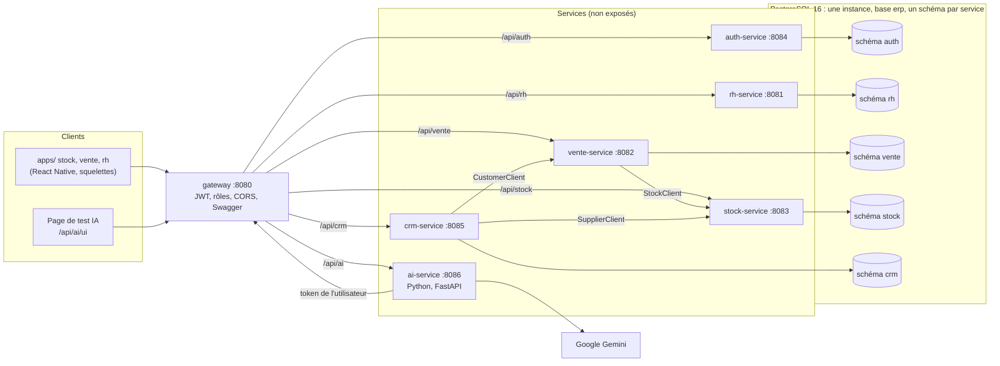
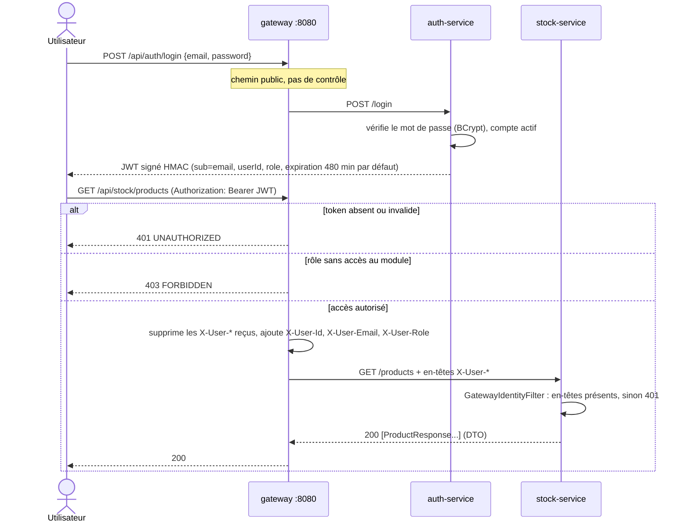
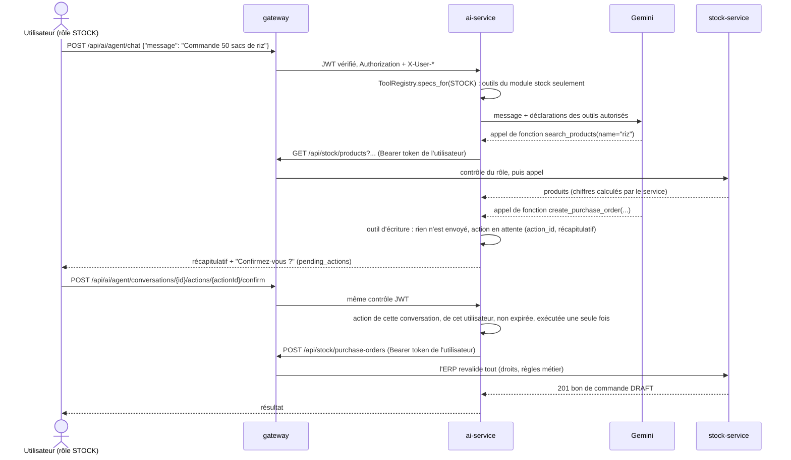

# Architecture de l'ERP

Ce document explique comment l'ERP est construit, comment une requête le traverse et pourquoi ces choix ont été faits. Les décisions sont détaillées dans [adr/](adr/README.md). Les endpoints sont listés dans [API_ENDPOINTS.md](API_ENDPOINTS.md), les fonctionnalités dans [FONCTIONNALITES.md](FONCTIONNALITES.md).

## 1. Vue d'ensemble

L'ERP est un ensemble de microservices. Chaque module métier (Stock, Vente, RH, CRM) est un service Spring Boot avec son propre schéma dans une instance PostgreSQL unique, accessible seulement par son utilisateur dédié ([ADR-006](adr/ADR-006-instance-postgresql-unique.md)). Un service d'authentification délivre les tokens JWT. Une gateway unique (Spring Cloud Gateway) est la seule porte d'entrée : elle vérifie le token, contrôle le rôle, puis transmet la requête au bon service. Un assistant IA (Python, FastAPI, Google Gemini) se place derrière la même gateway et n'utilise que les API métier, avec le token de l'utilisateur. Les applications React Native (`apps/`) sont encore des squelettes.



| Composant | Rôle | Port | Base |
|-----------|------|-----:|------|
| `gateway/` | Routage, vérification du JWT, contrôle des rôles, CORS, Swagger unique | 8080 | aucune |
| `services/rh-service` | Départements, employés, congés, pointage | 8081 | schéma `rh` (utilisateur `rh_svc`) |
| `services/vente-service` | Clients, ventes, chiffre d'affaires | 8082 | schéma `vente` (utilisateur `vente_svc`) |
| `services/stock-service` | Produits, mouvements, autonomie, fournisseurs, bons de commande | 8083 | schéma `stock` (utilisateur `stock_svc`) |
| `services/auth-service` | Comptes, connexion, émission du JWT | 8084 | schéma `auth` (utilisateur `auth_svc`) |
| `services/crm-service` | Échanges avec les tiers, chronologie | 8085 | schéma `crm` (utilisateur `crm_svc`) |
| `services/ai-service` | Assistant en langage naturel | 8086 | aucune (mémoire vive) |

La gateway retire le préfixe avant de transmettre (`/api/stock/products` devient `/products` sur le stock-service). L'instance PostgreSQL est publiée sur le port 5432 pour le développement.

Les services ne lisent jamais la base d'un autre. Quand un service a besoin d'une donnée d'un autre module, il l'appelle en HTTP :

- vente-service appelle stock-service (`StockClient`) pour lire le prix d'un produit et enregistrer les sorties de stock ;
- crm-service appelle vente-service (`CustomerClient`) et stock-service (`SupplierClient`) pour construire la chronologie d'un tiers.

Ces appels vont directement d'un service à l'autre sur le réseau interne (`STOCK_URL`, `VENTE_URL`), pas par la gateway. Ils recopient les en-têtes d'identité de la requête d'origine (`IdentityForwarding`).

## 2. Chemin d'une requête

### 2.1 Connexion puis appel d'un module



Les règles d'accès sont dans `gateway/.../RoleAccessPolicy.java` :

| Rôle | stock | vente | rh | crm | ai | auth (gestion des comptes) |
|------|:-----:|:-----:|:--:|:---:|:--:|:--------------------------:|
| `STOCK` | oui | non | non | non | oui | non |
| `VENTE` | non | oui | non | non | oui | non |
| `RH` | non | non | oui | non | oui | non |
| `CRM` | non | non | non | oui | oui | non |
| `ADMIN` | oui | oui | oui | oui | oui | oui |

Sont publics : `POST /api/auth/login`, la page `GET /api/ai/ui` et les définitions OpenAPI (`/api/<module>/v3/api-docs`). `/api/auth/users/me/**` (changement de son mot de passe) est ouvert à tout utilisateur connecté.

### 2.2 Valider une vente

La validation d'une vente touche deux schémas, chacun propriété d'un service. Il n'y a pas de transaction distribuée : vente-service débite le stock ligne par ligne et, si une ligne échoue, il remet en stock ce qui a déjà été débité (compensation). Code : `vente-service/.../sale/service/validator/SaleValidatorService.java`.

```mermaid
sequenceDiagram
    actor U as Utilisateur VENTE
    participant GW as gateway
    participant V as vente-service
    participant S as stock-service

    U->>GW: POST /api/vente/sales/{id}/validate
    GW->>V: POST /sales/{id}/validate + X-User-*
    V->>V: vente introuvable : 404 ; déjà validée : 409 IMMUTABLE
    loop pour chaque ligne
        V->>S: POST /products/{id}/movements {type: OUT} + X-User-* recopiés
        alt stock suffisant
            S-->>V: 201 mouvement créé
        else stock insuffisant ou produit inconnu
            S-->>V: 422 BUSINESS / 404
        end
    end
    alt toutes les lignes débitées
        V->>V: statut VALIDATED, date de validation
        V-->>U: 200 vente validée (immuable)
    else une ligne a échoué
        loop pour chaque ligne déjà débitée
            V->>S: POST /products/{id}/movements {type: IN, "Annulation vente #id"}
        end
        V-->>U: 422 BUSINESS (ou 503 si stock-service injoignable), vente restée DRAFT
    end
```

Si la compensation elle-même échoue, l'erreur est écrite dans les logs du vente-service. La correction se fait alors à la main par un mouvement de stock.

### 2.3 Question à l'assistant IA



L'utilisateur peut aussi confirmer en répondant « oui » dans le chat : Gemini appelle alors `confirm_action`, que le serveur refuse si l'appel a lieu dans le même tour que la proposition. L'IA ne peut donc pas se confirmer elle-même. Code : `ai-service/app/tools/registry.py`, `app/agent/confirmation.py`.

## 3. Sécurité

| Mesure | Où | Effet |
|--------|----|-------|
| JWT signé (HMAC, `JWT_SECRET`) | auth-service émet, gateway vérifie | Sans token valide : 401. Le secret est le même dans les deux. |
| Contrôle par rôle et par module | `RoleAccessPolicy` | Un rôle n'atteint que son module : 403 sinon. `ADMIN` atteint tout. |
| Identité imposée par la gateway | `GatewayAuthFilter` | Les en-têtes `X-User-*` envoyés par le client sont supprimés puis réécrits à partir du token. |
| Appels directs refusés | `GatewayIdentityFilter` dans chaque service | Sans `X-User-Id` et `X-User-Role` : 401. Swagger, `/actuator` et `/login` restent ouverts. |
| Ports des services non publiés | `docker-compose.yml` | Seuls la gateway (8080) et, avec le profil `ai`, l'ai-service (8086) sont publiés. L'instance PostgreSQL est publiée pour le développement. |
| CORS | `gateway/src/main/resources/application.yml` | Origines réglées par `CORS_ALLOWED_ORIGINS` (localhost par défaut). Les réponses 401 et 403 gardent l'en-tête CORS. |
| Erreurs typées | `GlobalExceptionHandler` de chaque service | Format commun `{status, type, message, timestamp}`, `type` parmi `NOT_FOUND`, `VALIDATION`, `IMMUTABLE`, `BUSINESS`, `SERVER`, `UNAUTHORIZED`, `FORBIDDEN`. Le détail d'une erreur inattendue reste dans les logs. |
| Données validées immuables | Updaters, Validators | Modifier une donnée validée renvoie 409 `IMMUTABLE`. Voir [ADR-004](adr/ADR-004-donnees-validees-immuables.md). |
| Mots de passe | auth-service | Hachés avec BCrypt. Un compte désactivé ne peut plus se connecter. |
| IA bornée par l'utilisateur | ai-service | Gemini ne reçoit que les outils du rôle ; chaque appel part avec le token de l'utilisateur et la gateway le revérifie ; aucune écriture sans confirmation humaine. |

Limites connues :

- **Pas de renouvellement de token.** Un token reste valable jusqu'à son expiration (`JWT_TTL_MINUTES`, 480 par défaut), même si le compte est désactivé entre-temps (tâche SYS-2).
- **En-têtes imitables si un port de service est exposé.** Les services font confiance aux en-têtes `X-User-*`. Quelqu'un qui atteint directement un port de service peut les inventer. En production : ne pas exposer ces ports, ou ajouter un secret partagé entre gateway et services.
- **Contrôle par module, pas par action.** Les services ne revérifient pas le rôle ; un rôle a tous les droits sur son module (tâche SYS-1).
- **ai-service.** Conversations et actions en attente sont en mémoire vive : perdues au redémarrage, une seule instance possible.
- Les valeurs par défaut (`admin1234`, secret JWT de développement) ne servent qu'en local.

## 4. Conventions de code

Les règles complètes sont dans [REGLES_DEVELOPPEMENT.md](REGLES_DEVELOPPEMENT.md). L'essentiel :

- Un package par entité : `controller`, `service/{reader,creator,updater,deleter}`, `repository`, `entity`, `dto`, `mapper`, plus `common/{exception,security,config}`. Les opérations spécifiques ont leur propre package (`validator`, `receiver`, `profile`, `decision`...).
- Chaque opération a une interface (`ProductReader`) et une implémentation (`ProductReaderService`). Les controllers dépendent des interfaces. Voir [ADR-003](adr/ADR-003-separation-reader-creator-updater-deleter.md).
- Les controllers ne renvoient que des DTO, jamais une entité JPA.
- 100 lignes maximum par fichier, une responsabilité par fichier.
- Commits et branches : [WORKFLOW_GIT.md](WORKFLOW_GIT.md).

## 5. Tests

| Module | Tests |
|--------|------:|
| gateway | 29 |
| auth-service | 42 |
| stock-service | 110 |
| vente-service | 78 |
| rh-service | 88 |
| crm-service | 38 |
| **Total Java** | **385** |

- **Tests unitaires** (JUnit 5 + Mockito) : chaque service Reader/Creator/Updater/Deleter, avec ses dépendances simulées. Cas nominal et cas d'erreur.
- **Tests de controllers** (`@WebMvcTest` + MockMvc) : statuts HTTP, validation des entrées, format des erreurs. Chaque controller des cinq services en a.
- **Gateway** : tests du filtre JWT, de la politique d'accès par rôle et du CORS.
- **ai-service** : tests `pytest` sans réseau, avec un faux Gemini et une fausse gateway (`tests/fake_gemini.py`, `tests/fake_erp.py`) : registre et rôles, confirmation, orchestrateur, flux SSE.

Lancer : `mvn test` dans chaque module Java, `python -m pytest -q` dans `services/ai-service`. Les tests Java tournent sur H2 ; il n'y a pas encore de test sur PostgreSQL (SYS-15) ni d'intégration continue (SYS-11).

## 6. L'IA : l'exploiter sans lui céder la main

Le thème demande s'il faut combattre l'IA ou l'exploiter. Notre réponse : l'exploiter là où elle est forte, la contenir là où elle peut se tromper.

**Ce que l'IA apporte aujourd'hui :**

- Un assistant en langage naturel qui lit tous les modules autorisés (stock, ventes, clients, RH, chronologie CRM) et répond en une phrase.
- Des prévisions simples expliquées en clair : l'autonomie d'un produit (vente moyenne sur 7 jours, jours restants, risque `OK`/`WARNING`/`CRITICAL`) devient « environ 2 jours de stock ».
- Des actions préparées : mouvement de stock, bon de commande, vente, proposés par l'IA et exécutés après accord.

**Ce qui la contient :**

- **Les droits.** L'IA n'a jamais plus de droits que l'utilisateur : elle ne voit que les outils de son rôle et appelle l'ERP avec son token. La gateway revérifie chaque appel.
- **La confirmation humaine.** Toute écriture est mise en attente ; elle n'est exécutée que sur un clic ou un accord dans un tour suivant. Elle expire et ne s'exécute qu'une fois.
- **Les chiffres viennent du code.** Les calculs (stock, autonomie, chiffre d'affaires, fiches 360) sont faits par les services Java. L'IA choisit l'outil et met en forme ; elle n'invente pas de données (consigne du prompt) et l'ERP revalide toute écriture.
- **Une liste fermée d'outils.** Gemini ne peut appeler que des fonctions déclarées ; leurs arguments sont validés (Pydantic) avant tout appel.

**En cours sur d'autres branches**, pas encore fusionnées et donc non décrites ici (détail dans [NEW_FEATURES_IMPLEMENTATION.md](NEW_FEATURES_IMPLEMENTATION.md), ajouté avec ces branches) : Invoice Shield (contrôle anti-fraude des factures fournisseurs), vérification des chiffres cités par l'IA, journal des actions de l'IA, prévision de réapprovisionnement.

## 7. Déploiement

`docker compose up -d --build` démarre l'instance PostgreSQL unique, les cinq services Java et la gateway, chacun avec une limite mémoire. L'ai-service démarre avec le profil `ai` (`docker compose --profile ai up -d --build`) ; il joint alors la gateway via `host.docker.internal`, prévu pour des services Java lancés sur la machine. Toutes les images Java utilisent `docker/Dockerfile.java`. Chaque service peut aussi tourner seul avec `mvn spring-boot:run`, ou avec le profil `h2` (base en mémoire) sans PostgreSQL.
